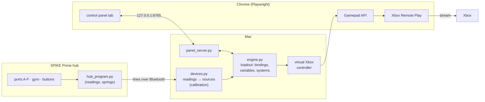

# LEGO SPIKE controller: custom software V1

> One program for **every** controller design. The earlier, one-design-each versions are in [`../v2.1`](../v2.1/README.md), [`../v2`](../v2/README.md) and [`../v1`](../v1/README.md).

V1, V2 and V2.1 each had their own software, written for one LEGO build. Every new design meant new code. Custom software V1 turns that around:

1. It **finds what is plugged into the hub** (motors, force sensors, distance sensors, colour sensors on ports A-F, plus the hub's gyro and buttons).
2. It **calibrates** whatever it found, and shows the calibration in the control panel, where every value can be changed.
3. You **build the controls in a control panel**: which LEGO input gives which Xbox input, with deadzones, activation areas, variables, systems and remaps.
4. Those controls are saved as a **loadout** (a JSON file in [`loadouts/`](loadouts/)). Make one per controller design or per game, and switch between them.

Like V2 and V2.1, the hub talks to the computer over Bluetooth with the normal LEGO firmware, and the controller shows up in Chrome as an **Xbox controller** for **Xbox Remote Play**. No keyboard or mouse emulation is involved.

| File | What it does |
|---|---|
| `app.py` | **The main program.** Connects to the hub, detects the ports, uploads the hub program, opens Chrome (Xbox Remote Play + the control panel) and plays. |
| `engine.py` | The binding engine: LEGO values in, Xbox controller out, following the loadout. Also checks loadouts for mistakes. |
| `devices.py` | Port detection, and turning the hub's readings into values (using the calibration). |
| `calibration.py` | The calibration wizard. Its steps are made from whatever was detected. |
| `hub_program.py` | Runs **on the hub**. Reports every reading, and runs motor springs. `app.py` fills in the ports and uploads it. |
| `chrome.py` | Chrome with the virtual Xbox controller in its Gamepad API (same method as V1-V2.1). |
| `panel.html`, `panel_server.py` | The control panel and the small web server (on this computer only) that serves it. |
| `check_chrome.py` | Checks that Chrome sees the virtual controller. No hub needed. |
| `loadouts/` | Saved loadouts. Three come with it: `example-everything.json`, `v2-1-controller.json`, `empty.json`. |
| `spike/` | The SPIKE Prime Bluetooth protocol (the same as V2 and V2.1). |
| `calibration.json`, `settings.json` | Made when you use it: your calibration and the last loadout you opened. Personal, so git ignores them. |

## Setup

All the versions share one Python virtual environment at the root of the repository. From the repository root:

```bash
python3 -m venv .venv
.venv/bin/pip install -r customsoftwarev1/requirements.txt
cd customsoftwarev1
```

That installs [bleak](https://github.com/hbldh/bleak) (Bluetooth) and [Playwright](https://playwright.dev/python/) (it starts your normal Google Chrome). **All commands below run from the `customsoftwarev1/` folder.** The first time it uses Bluetooth, macOS asks whether your terminal may use it: allow it.

## Running

1. Turn on the hub, press its **Bluetooth button** (the light blinks), and close the SPIKE app. The hub accepts only one connection.
2. Start it:
   ```bash
   ../.venv/bin/python app.py
   ```
3. Chrome opens with two tabs: **Xbox Remote Play** and the **control panel**. Drag the control panel tab out of the window if you want both side by side. The control panel also works in any browser at <http://127.0.0.1:8765/>.
4. The first time (and whenever the devices on the ports change), the **calibration wizard** starts in the control panel. See [Calibration](#calibration).
5. Open a loadout on the **Loadouts** tab, or build your own on the **Bindings** tab.
6. In the Remote Play tab: sign in if asked, pick your Xbox, press **Remote play**, and play.

**One-time setup on the Xbox:** **Settings → Devices & connections → Remote features → Enable remote features**, with the power mode set to **Sleep**.

**To stop**, close Chrome or press **Ctrl+C**. Every virtual button is released when it stops, and also if the hub goes quiet for 2 seconds. If you press the hub's centre button, the hub program stops but the control panel stays open: press **Restart hub program** in its header.

| Command | What it does |
|---|---|
| `../.venv/bin/python app.py` | **Play**: Remote Play + control panel |
| `../.venv/bin/python app.py --panel-only` | Chrome opens only the control panel (set things up first) |
| `../.venv/bin/python app.py --no-chrome` | No Chrome: open <http://127.0.0.1:8765/> in any browser. The virtual Xbox controller only exists in the Chrome that `app.py` opens, so this is for setting up |
| `../.venv/bin/python app.py --no-hub` | **No hub needed**: build and test loadouts, with a slider for every input |
| `../.venv/bin/python app.py --calibrate` | Run the calibration wizard again |
| `../.venv/bin/python app.py --loadout v2-1-controller` | Start with this loadout |
| `../.venv/bin/python app.py --name <hub name>` | Only connect to the hub with this Bluetooth name |
| `../.venv/bin/python app.py --slot 5` | Use another program slot on the hub (0-19, default 0) |
| `../.venv/bin/python app.py --panel-port 9000` | Serve the control panel on another port |
| `../.venv/bin/python check_chrome.py` | **No hub needed**: check that Chrome's Gamepad API sees every input (`--show` to watch) |
| `../.venv/bin/python -m unittest discover -s tests` | Run the tests |

Chrome uses the same profile as V1-V2.1 (`~/Library/Application Support/lego-spike-game-controller/chrome-profile`), so you stay signed in to Xbox.

**Try it without a hub first:** `../.venv/bin/python app.py --no-hub --panel-only --loadout example-everything`. Drag the sliders on the **Live** tab and watch the Xbox controller.

## The ideas

Everything is made of four things: **sources**, **bindings**, **variables** and **systems**.

### Sources: the LEGO inputs

A source is one number from the controller. The control panel lists the ones it found; the names are also what the loadout files use.

| Source | Value |
|---|---|
| `motor:A` | the motor's angle in degrees, from its calibrated rest position (negative the other way) |
| `force:C` | force sensor, 0-100 |
| `distance:D` | distance sensor in **centimetres**. Seeing nothing counts as 250 cm (or as 0 cm, if calibration found that your hand covering the sensor reads as "nothing") |
| `color:E`, `color:E:reflection` | colour sensor: the colour number (-1 none, 0 black, 1 magenta, 2 purple, 3 blue, 4 azure, 5 turquoise, 6 green, 7 yellow, 8 orange, 9 red, 10 white), and reflected light 0-100 |
| `gyro:right` | hub tilt to the right like a steering wheel, in degrees (negative = left) |
| `gyro:forward` | hub tilt away from you (negative = towards you) |
| `gyro:pitch`, `gyro:roll`, `gyro:yaw` | the raw tilt angles, from the calibrated level position |
| `hub:left`, `hub:right` | the hub's left and right buttons: 1 while pressed, 0 otherwise |
| `var:<name>` | any variable you made |

The hub's centre button always stops the hub program (LEGO firmware), so it can't be bound.

### Bindings: what a source does

There are three kinds:

**Zone** (an activation area). The binding is **active** while the source is:

| Mode | Active when |
|---|---|
| `above` | the value is at or above *a* |
| `below` | the value is at or below *a* |
| `between` | the value is between *a* and *b* |
| `outside` | the value is below the lower or above the higher of *a* and *b* |
| `at` | the value is exactly *a* (for variables and buttons) |

**Hysteresis** stops flicker at the edge: once active, the value has to move this much back out before the binding lets go. For example a motorised button `above 25` with hysteresis 8 presses at 25° and lets go at 17°.

While active, a zone binding runs its **actions**, all together:

| Action | What it does |
|---|---|
| `hold` | holds one or more Xbox outputs while active. Pick several for **many inputs in one activation** (for example Y + B + RB) |
| `tap` | presses outputs once, when the binding activates (or when it deactivates). With *repeat every (ms)* it keeps tapping while active (turbo) |
| `toggle` | each activation latches the outputs on or off |
| `var_add` | adds an amount to a variable (negative to subtract). With *repeat every (ms)* it keeps adding while active |
| `var_set` | sets a variable to a number |
| `var_reset` | puts a variable back to its start value |
| `remap` | **changes other bindings' outputs** while active: `dpad_up → y`, or a whole stick: `ls → rs`. Optionally only for chosen bindings |
| `system` | switches a system on, off, or toggles it |

**Axis**. The source moves one stick axis, or LT / RT as an analog trigger. It has a **deadzone** (from ... to ...): inside it the axis stays centred. Past the deadzone the axis moves, and it is pushed all the way at the range's ends (the motor's calibrated range unless you type one). *Invert* flips the direction.

**Stick**. Two sources move a whole stick, for example `gyro:right` and `gyro:forward`. It has a **round deadzone**, a *full at* value, and **directions**: smooth, 4 (N E S W), or 8 (N NE E SE S SW W NW), so the stick snaps to the nearest one.

Every binding can also have **conditions**: it only works while they are all true (for example `var:mode at 1`).

### Xbox outputs

Every input of an Xbox controller:

| | Outputs |
|---|---|
| Face buttons | `a` `b` `x` `y` |
| Shoulders | `lb` `rb`, and `lt` `rt` (as buttons, or analog from an axis binding) |
| D-pad | `dpad_up` `dpad_down` `dpad_left` `dpad_right` |
| Other buttons | `view` `menu` `xbox`, and the stick clicks `ls_click` `rs_click` |
| Stick directions (8 per stick) | `ls:n` `ls:ne` `ls:e` `ls:se` `ls:s` `ls:sw` `ls:w` `ls:nw`, and the same with `rs:` |
| Stick axes | `ls:x` `ls:y` `rs:x` `rs:y`: x is west (-1) to east (+1), y is south (-1) to north (+1) |

The Share button isn't in Chrome's standard gamepad layout, so Remote Play can't receive it from a virtual controller.

When several bindings push the same stick, their pushes add up (and stay inside the stick's circle). Buttons are pressed if any binding presses them. Every press lasts at least 100 ms (*shortest press* on the Loadouts tab), so Remote Play never misses a quick tap.

### Variables

Numbers your bindings can change and react to. Each has a **start value**, an optional **minimum** and **maximum** (it never goes past them), and **wrap**: going past one end jumps to the other, which is handy for modes (0, 1, 2, 0, ...).

- **Increase it** with a `var_add` action (for example `+1` every time a force sensor is pressed, or `-1` per shot).
- **Do an input when it reaches a number**: a zone binding with the variable as its source, for example `var:ammo at 0 → tap X`, or `var:charge above 10 → hold RT`, or `between 3 and 5`.
- **Reset it** with a `var_reset` action, or with the Reset button on the Live tab.

Variables start from their start value every time the loadout is opened.

### Systems

A system is a named group of bindings. A system can be switched on or off (on the Live tab, or with a `system` action), and it can have **conditions**, so that its bindings only work while they are true. With a variable this makes **modes**: a "Walking" system with the condition `var:moving at 1`, a "Driving" system with `var:vehicle at 1`, and a hub button that changes the variable.

## The examples from the request, step by step

**A motor gives D-pad up when turned to -30°, and a force sensor changes that D-pad up into Y.**
1. Add a zone binding: source `motor:E`, active when `below` `-30`, action `hold` D-pad ↑.
2. Add a zone binding: source `force:C`, `above` `10`, action `remap` from D-pad ↑ to Y (optionally only for the first binding).

**A motor moves the left stick, and a distance sensor makes it the right stick when something is closer than 10 cm.**
1. Add an axis binding: source `motor:B`, moves *Left stick south ↕ north*.
2. Add a zone binding: source `distance:D`, `below` `10`, action `remap` from *Left stick (whole)* to *Right stick (whole)*.

**A motor on the east-west axis of the right stick with a deadzone from -10 to 24 degrees.**
Add an axis binding: source `motor:F`, moves *Right stick west ↔ east*, deadzone from `-10` to `24`. Past 24° the stick goes east, below -10° west.

**8 directions of a stick.** Either a zone binding that holds `ls:ne` (or any of the 16 directions), or a stick binding with *directions: 8*.

**Several Xbox inputs at once.** One zone binding, one `hold` (or `tap`) action, several outputs picked.

All of these are in `loadouts/example-everything.json`, together with variables (ammo, mode) and a system that only works in mode 1.

## Calibration

The wizard's steps are made from what is plugged in. Capture each step with the **Capture** button or the **right hub button**:

1. **Rest position.** Every motor at rest, hands off, controller held level. Saves each motor's rest angle (its 0°), the force sensors' resting values, what the distance sensors see without a hand, and the gyro's level position.
2. **Each motor's range.** Move it as far as it goes both ways. Axis bindings use this range when they don't have their own.
3. **Each force sensor.** Press as hard as you will while playing. Saves the strongest press, and a "pressed from" value (30% of the way).
4. **Each distance sensor.** Hold your hand over it. Saves a "near" distance, and whether a covered sensor reads "nothing" (some do; then "nothing" counts as 0 cm).
5. **Tilt right**, then **tilt forward**. Works out which way is right and forward however the hub sits in the build, for `gyro:right` and `gyro:forward`.

Everything is saved in `calibration.json` and shown on the **Devices & calibration** tab, where every value can be changed by hand (then press *Save calibration*). That tab also has:

- **Motor mode.** *Absolute*: the motor's rest position is remembered between runs (angles -180° to 180°). *Relative*: the rest position is wherever the motor is when the program starts, and it can turn endlessly (for a dial or a wheel).
- **Invert direction** for a motor that counts the wrong way.
- **Spring**: the motor pushes itself back to rest, harder the further it is moved, so a motorised button pops back up like a real button (as in V2.1). *Strength* is motor power per degree, *max power* caps it (power runs 0-10000). It switches itself off past 90° for safety.
- **Source deadzones**: a value inside the deadzone reads as 0 for every binding. For example ±3° on `gyro:right`, or a few degrees of wobble on a motor at rest. Bindings have their own deadzones and activation areas on top.
- **Rescan ports**, when you plugged something in or out.

## Loadout files

A loadout is a JSON file in `loadouts/`, so it can also be written or shared by hand. The control panel checks it and says what is wrong. A short one:

```json
{
  "name": "My design",
  "description": "",
  "settings": {"min_press_ms": 100},
  "variables": [{"name": "ammo", "initial": 5, "min": 0, "max": 5, "wrap": false}],
  "systems": [{"id": "main", "name": "Main", "enabled": true, "conditions": []}],
  "bindings": [
    {"id": "jump", "name": "Motor A pressed: jump", "system": "main", "kind": "zone", "enabled": true,
     "source": "motor:A", "zone": {"mode": "above", "a": 25, "b": null, "hysteresis": 8},
     "actions": [{"type": "hold", "outputs": ["a"]}], "conditions": []},
    {"id": "swap", "name": "Force: D-pad up becomes Y", "system": "main", "kind": "zone", "enabled": true,
     "source": "force:C", "zone": {"mode": "above", "a": 10, "b": null, "hysteresis": 5},
     "actions": [{"type": "remap", "from": "dpad_up", "to": "y", "targets": []}], "conditions": []},
    {"id": "aim", "name": "Motor F: right stick west-east", "system": "main", "kind": "axis", "enabled": true,
     "source": "motor:F", "output": "rs:x", "deadzone": [-10, 24], "range": null, "invert": false, "conditions": []},
    {"id": "walk", "name": "Tilt to walk", "system": "main", "kind": "stick", "enabled": true,
     "x_source": "gyro:right", "y_source": "gyro:forward", "output": "ls",
     "deadzone": 6, "full": 30, "invert_x": false, "invert_y": false, "directions": 8, "conditions": []}
  ]
}
```

| Field | Values |
|---|---|
| action fields | `hold` / `toggle`: `outputs`. `tap`: `outputs`, `on` (`activate` / `deactivate`), `repeat_ms`. `var_add`: `var`, `amount`, `repeat_ms`, `on`. `var_set`: `var`, `value`, `on`. `var_reset`: `var`, `on`. `remap`: `from`, `to`, `targets` (binding ids, empty = all). `system`: `system`, `mode` (`on` / `off` / `toggle`), `on` |
| conditions | `{"source": "var:mode", "mode": "at", "a": 1, "b": null}` (the same modes as zones) |
| axis `range` | `[min, max]`, or `null` for the calibrated range |
| stick `directions` | `0` smooth, `4` or `8` |

When the control panel saves a loadout it also writes `devices` (what was plugged in), just for reference.

## The control panel

| Tab | |
|---|---|
| **Live** | Every source with its live value (sliders with `--no-hub`), the Xbox controller that Chrome gets, variables (with −1 / +1 / Reset), systems (on / off), the remaps that are active, and an action log |
| **Bindings** | The bindings, grouped by system, with a green dot while active. The editor shows the live value on a bar with the activation area, a **◉ now** button that copies the live value into a number (move the motor to -30°, press it), the output picker, actions and conditions |
| **Variables & systems** | Make, rename and limit variables. Make systems and give them conditions |
| **Devices & calibration** | The calibration wizard, every calibration value, motor modes and springs, source deadzones, rescanning the ports |
| **Loadouts** | Open, save, save as new, delete. The name, description and shortest press of this loadout |

Changes work **straight away** while you play; **Save** writes them to the file. *Release all* lets go of every Xbox button at once.

## How it works



1. **Connecting.** `app.py` connects to the hub over Bluetooth Low Energy with the LEGO SPIKE Prime protocol (`spike/`), and reads the hub's sensor stream once to see what is on each port.
2. **The hub program is generated** for those ports: `hub_program.py` with its CONFIG block filled in (which ports to read, motor modes, rest positions, springs), uploaded and started. It knows nothing about Xbox buttons. It prints one short line per change: `A E -31` (motor E's angle), `F C 42` (force), `D D 95` (distance in mm), `C B 3 55` (colour, reflection), `T 0 -4 12` (yaw, pitch, roll), `B R 1` (right hub button). Springs run on the hub so they never wait for Bluetooth.
3. **Readings become sources.** `devices.py` applies the calibration (rest positions, inverting, the tilt directions, source deadzones) and turns millimetres into centimetres.
4. **The engine runs the loadout** about 100 times a second: it works out which bindings are active (systems, conditions, zones with hysteresis), runs the actions when they activate, applies the remaps, adds up the sticks, and keeps every press at least 100 ms long.
5. **Chrome gets a virtual Xbox controller.** Playwright starts Chrome with a script in every page that makes `navigator.getGamepads()` return a standard-mapping Xbox controller, which `app.py` updates. Xbox Remote Play reads it like a real controller. (macOS only lets Apple-approved apps create a system-wide virtual controller, so the controller lives inside that Chrome window.)
6. **The control panel** is a page served by `panel_server.py` on 127.0.0.1 only. It polls the live state 10 times a second and sends edits back. Other websites can't use it: it only answers requests addressed to 127.0.0.1 / localhost, and changes need a header that other sites can't send.

The V2 [HOW_IT_WORKS.md](../v2/HOW_IT_WORKS.md) explains the Bluetooth protocol and the virtual gamepad in more detail.

## Testing

```bash
../.venv/bin/python -m unittest discover -s tests   # engine, readings, calibration, hub program maths
../.venv/bin/python check_chrome.py                  # real Chrome: does the Gamepad API see every input?
```

**What has been tested:**
- **Software:** the 36 unit tests and `check_chrome.py` pass. The control panel was used with `--no-hub`: sliders, every tab, editing a loadout while it runs, and the remap / stick-swap / 8-direction examples.

**Not tested yet (no hub was connected while it was written):**
- the generated hub program on a real hub: port detection, the readings, `motor.absolute_position`, colour sensors, springs
- the calibration wizard with real readings
- Remote Play with a real game

The hub side reuses V2.1's Bluetooth code and the same hub program style, but run it with `--panel-only` the first time and check the **Live** tab before playing.

## Troubleshooting

| Problem | Fix |
|---|---|
| `No SPIKE hub found` / *Could not connect* | Wake the hub, press its Bluetooth button, close the SPIKE app and other scripts, then press **Connect** in the control panel. |
| `Port 8765 is in use` | The program is already running, or use `--panel-port 9000`. |
| A motor counts the wrong way | Tick *Invert direction* for it on the Devices & calibration tab. |
| A motor's angle jumps by 360° | It turns past its ±180° edge in *absolute* mode. Run the wizard with it at rest, or use *relative* mode. |
| A binding flickers at its edge | Raise its hysteresis. |
| The gyro moves things while you hold it still | Add a source deadzone (for example `gyro:right` from -3 to 3) or raise the binding's deadzone. |
| A motorised button doesn't pop back up / is too stiff | Spring on, and raise / lower *strength* and *max power*. |
| `Hub warning: spring on ... off` | It went past 90° with the spring on, so the spring may push the wrong way. Check the build, or switch that spring off. |
| Lines starting with `hub:` in the terminal | An error from the hub program. Every input is released. Press **Restart hub program**. |
| The panel says *program not running* | `app.py` stopped: start it again. |
| The game doesn't react | Play in the Chrome window that `app.py` opened. The Live tab shows what the virtual controller sends. |

## License

MIT, see [LICENSE](../LICENSE). `spike/protocol.py` is modified from the LEGO Group's SPIKE Prime protocol example (Apache 2.0); the details are in LICENSE. Not affiliated with the LEGO Group or Microsoft.
