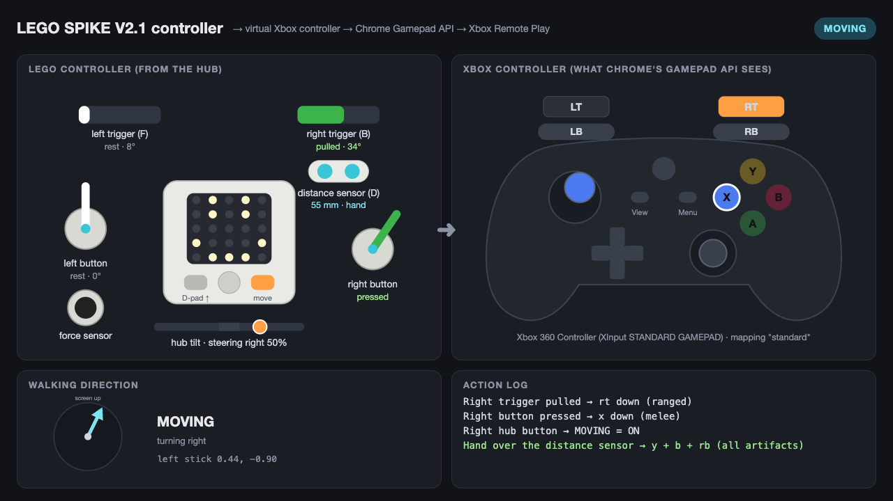
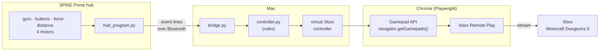

# LEGO SPIKE controller for Minecraft Dungeons II (V2.1)

> The third controller design. The earlier ones are in [`../v2`](../v2/README.md) and [`../v1`](../v1/README.md).

V2.1 is a new LEGO build of the controller, with its own software. The hub has:
- two motorised buttons
- two back triggers, **each on its own large angular motor**
- a force sensor
- a **distance sensor** for the artifacts

Like V2, it talks to the computer over Bluetooth using the normal LEGO firmware: `bridge.py` uploads a MicroPython program to the hub and starts it. On the computer, the controller shows up in Chrome as an **Xbox controller** and plays **Minecraft Dungeons II** through **Xbox Remote Play**. The game sees real held buttons, triggers and an analog stick. No keyboard or mouse emulation is involved.



| Program | What it does |
|---|---|
| `bridge.py` | **The main program.** It connects to the hub, uploads the hub program, opens Chrome on Xbox Remote Play with the virtual Xbox controller, and plays. With `--tester` it opens the dashboard instead. |
| `hub_program.py` | Runs **on the hub**. `bridge.py` uploads and starts it for you. |
| `controller.py` | The rules: LEGO inputs in, Xbox controller out. |
| `config.py` | Ports, every threshold and every Xbox button mapping, in one place. |
| `dashboard.html` | The live dashboard page that `bridge.py --tester` opens. |
| `check_chrome.py` | Checks that Chrome sees the virtual controller. No hub needed. |

## The controller

| Part | Port | In the game |
|---|---|---|
| **Right motorised button** | E or A | **Melee** (X), held while pressed |
| **Left motorised button** | A or E | **Jump** (A), held while pressed |
| **Right back trigger** (large motor) | B | **Ranged attack** (RT), held while pulled |
| **Left back trigger** (large motor) | F | **LT** (health potion), held while pulled |
| **Force sensor** | C | **LB** (forward dodge), held while pressed |
| **Distance sensor**, next to the right trigger | D | Hand over it: **all three artifacts at once** (Y + B + RB) |
| **Left hub button** | | **D-pad up** (inventory), held while pressed |
| **Right hub button** | | **Start / stop moving** |
| **Hub gyro** | | **Steering**: tilt left / right to turn the walking direction |

The Xbox buttons are the Minecraft Dungeons II defaults ([dungeons.tools](https://www.dungeons.tools/2/controls)): X melee, A jump, RT ranged, LT potion, LB forward dodge, Y / B / RB artifacts, D-pad up inventory. If the game does something else, change `BUTTONS` or `ARTIFACTS` in [`config.py`](config.py).

The two motorised buttons are the same kind of motor, so calibration asks you to press each one to learn which is on the right. Every other part has to be on the port in the table. `bridge.py` checks this and tells you if a cable is in the wrong port. The ports can be changed at the top of `config.py`.

### Held buttons and triggers

Every button and trigger acts like the one on a real controller: the Xbox button goes down when you press or pull, **stays down for as long as you hold it**, and comes up when you let go. Holding the right trigger keeps the bow drawn, exactly like holding RT.

The buttons and triggers are motors, so the hub knows their exact angle:

- **Pressed** past 25° for a button, or pulled past 20° for a trigger.
- **Released** once it moves back 8° (button) or 5° (trigger) from the deepest point. Small wobbles while you hold it never let go by accident.
- The motorised buttons have a **spring**: their motor pushes them back towards rest, harder the further they are pressed, so they pop back up when you let go, like a real button.
- After a release, the **motor drives itself back to rest**: the buttons and the triggers both end up exactly where they started.

### Moving and steering

Minecraft Dungeons II needs a direction to walk in, and V2.1 has no joystick, so the player walks by themselves and you steer:

1. **Press the right hub button**: MOVING = ON, and your player starts walking (up the screen at first).
2. **Tilt the controller left or right**, like a steering wheel, to turn. The further you tilt, the faster it turns (up to 180° per second at a 30° tilt). Hold it roughly level (within 6°) to walk straight.
3. **Press the right hub button again** to stop: MOVING = OFF.

The gyro only steers. It never starts or stops walking, and while you are standing still, tilting does nothing. The player faces where they walk, so steering turns the looking direction too. The walking direction is kept between stops, so the next walk carries on the same way.

### Artifacts: the distance sensor

Hold your hand over the distance sensor, and **all three artifacts fire at once** (Y, B and RB together, as a quick press). They fire once per hand: take your hand away, and they can fire again. After a use there is a 0.8 s pause before the next one, so taking your hand away never fires them twice.

How close is close enough is set during calibration, from your own hand. Some distance sensors read nothing at all when a hand is right on top of them, and calibration notices this and treats "nothing" as your hand.

## Setup

V1, V2 and V2.1 share one Python virtual environment at the root of the repository. From the repository root:

```bash
python3 -m venv .venv
.venv/bin/pip install -r v2.1/requirements.txt
cd v2.1
```

That installs [bleak](https://github.com/hbldh/bleak) (Bluetooth) and [Playwright](https://playwright.dev/python/), which starts and controls your normal Google Chrome. **All commands below run from the `v2.1/` folder.** The first time `bridge.py` uses Bluetooth, macOS asks whether your terminal may use it: allow it.

## Playing

1. Turn on the hub, press its **Bluetooth button** (the light blinks), and close the SPIKE app. The hub accepts only one connection.
2. Leave both motorised buttons and both back triggers **at rest**. Their position when the program starts counts as 0°.
3. Check the controller on the dashboard:
   ```bash
   ../.venv/bin/python bridge.py --tester
   ```
   The first time, this calibrates first (see below).
4. Close Chrome, then play:
   ```bash
   ../.venv/bin/python bridge.py
   ```
   Chrome opens on [Xbox Remote Play](https://www.xbox.com/play/consoles). Sign in if asked, pick your Xbox, press **Remote play**, and start Minecraft Dungeons II.

**One-time setup on the Xbox:** **Settings → Devices & connections → Remote features → Enable remote features**, with the power mode set to **Sleep**.

Chrome uses its own profile in `~/Library/Application Support/lego-spike-game-controller/chrome-profile`, shared with V1 and V2, so you stay signed in. **Only the Chrome window that `bridge.py` opens** has the LEGO controller.

**To stop**, close Chrome or press **Ctrl+C**. The hub's centre button also stops it. Every virtual button is released when it stops, and also if the hub goes quiet for 2 seconds. Then the player stops moving as well.

| Command | What it does |
|---|---|
| `../.venv/bin/python bridge.py` | **Play** on Xbox Remote Play |
| `../.venv/bin/python bridge.py --tester` | The **dashboard**: the LEGO controller and the Xbox controller side by side, live |
| `../.venv/bin/python bridge.py --no-chrome` | Don't open Chrome; only print what the controller does |
| `../.venv/bin/python bridge.py --calibrate` | **Calibrate** again, then carry on |
| `../.venv/bin/python bridge.py --name <hub name>` | Only connect to the hub with this Bluetooth name |
| `../.venv/bin/python bridge.py --slot 5` | Use another program slot on the hub (0-19, default 0) |
| `../.venv/bin/python check_chrome.py` | **No hub needed**: check that Chrome's Gamepad API sees every input (`--show` to watch) |
| `../.venv/bin/python -m unittest discover -s tests` | Run the tests |

### Calibrating

Calibration runs by itself the first time, and again whenever the ports in `config.py` change. It takes about a minute:

```
Ports OK: buttons on E and A, right trigger on B, left trigger on F, force sensor on C, distance sensor on D.
Uploading hub_program.py to slot 0...

Finding the motorised buttons and the back triggers.
  Press the RIGHT motorised button (melee)...
    port A, + direction
  Now put it back to rest.
  Press the LEFT motorised button (jump)...
  ...

Calibrating the steering tilt. Hold the controller the way you play.
  Hold it LEVEL, then press the RIGHT hub button.
  Tilt it to the RIGHT, like turning a steering wheel, then press the RIGHT hub button.
    right tilt 32° (full steering at 30°).

Calibrating the distance sensor (artifacts).
  Hold your hand over the distance sensor, as close as you will in the game, then press the RIGHT hub button.
    48 mm
  Take your hand away, then press the RIGHT hub button.
    sees nothing
    artifacts when your hand is closer than 72 mm.
Saved to calibration.json.
```

`calibration.json` belongs to one controller, so git ignores it. **If you swap the two button cables, run `--calibrate`.**

### Reading the terminal

```
  Right trigger pulled -> rt down (ranged)
STANDING  heading     0°  stick +0.00,+0.00  buttons: rt
  Right hub button -> MOVING = ON
MOVING    heading    37°  stick +0.60,-0.80  buttons: -
  Hand over the distance sensor -> y + b + rb (all artifacts)
MOVING    heading    52°  stick +0.79,-0.62  buttons: b y rb
```

## Tuning

Everything is in [`config.py`](config.py), with a comment on every value. Restart `bridge.py` after a change: it uploads the new values to the hub.

| Setting | Default | What it does |
|---|---|---|
| `BUTTON_PORTS`, `..._PORT` | E A / B / F / C / D | where each part is plugged in |
| `BUTTONS`, `ARTIFACTS` | see [the table](#the-controller) | which Xbox button each input sends |
| `BUTTON_PRESS_DEG` / `BUTTON_RELEASE_DEG` | 25° / 8° | how far to press a motorised button / ease back to release |
| `TRIGGER_PULL_DEG` / `TRIGGER_RELEASE_DEG` | 20° / 5° | how far to pull a trigger / ease back to release |
| `AUTO_RETURN` | on | the motors drive back to rest after a release |
| `BUTTON_SPRING`, `SPRING_STRENGTH` / `SPRING_MAX` | on, 100 / 3000 | the motorised buttons' spring, and how hard it pushes (motor power runs 0-10000) |
| `STEER_DEADZONE_DEG` / `STEER_FULL_DEG` | 6° / 30° | tilt for no steering / the fastest steering |
| `STEER_TURN_RATE` | 180°/s | how fast the walking direction turns at a full tilt |
| `MOVE_SPEED` | 1.0 | how far the stick is pushed while moving (0-1) |
| `ARTIFACT_NEAR_MM` | from calibration | how close the hand must be (a number overrides the calibration) |
| `ARTIFACT_COOLDOWN_S` | 0.8 s | the shortest time between two artifact uses |
| `FORCE_PRESS` / `FORCE_RELEASE` | 10 / 5 | force sensor press / release levels (0-100) |
| `MIN_PRESS_S` | 0.1 s | the shortest press sent to the game, so a quick tap is never missed |

## How it works



1. **Connecting.** `bridge.py` connects to the hub over Bluetooth Low Energy with the LEGO SPIKE Prime protocol (`spike/`). It reads the hub's sensor stream to check the ports, then uploads `hub_program.py` with the values from `config.py` filled in, and starts it.
2. **The hub reports changes**, one short line each: `M B +` (right trigger pulled), `M B 0` (released), `F 1` (force sensor pressed), `D 48` (distance), `T 12 -3` (tilt), `B R 1` (right hub button). The press and release detection and the motors' return to rest run on the hub, so they never wait for Bluetooth.
3. **The rules turn events into Xbox controls.** `controller.py` holds and releases Xbox buttons, fires the artifacts, and turns the tilt into a walking direction for the left stick.
4. **Chrome gets a virtual Xbox controller.** Playwright starts Chrome with a script in every page that makes `navigator.getGamepads()` return a standard-mapping Xbox controller, which `bridge.py` updates live. Xbox Remote Play reads it like a real controller. (macOS only lets Apple-approved apps create a system-wide virtual controller, so the controller lives inside that Chrome window.)

The V2 [HOW_IT_WORKS.md](../v2/HOW_IT_WORKS.md) explains the Bluetooth protocol and the virtual gamepad in more detail. V2.1 uses the same `spike/` and `gamepad.py`.

## Testing

```bash
../.venv/bin/python -m unittest discover -s tests   # the rules, the hub's lever logic, ports, calibration maths
../.venv/bin/python check_chrome.py                  # real Chrome: does the Gamepad API see every input?
```

**What has been tested:**
- **Software:** the tests and `check_chrome.py` pass.
- **Hardware:** calibration ran on the real V2.1 build. On the dashboard every input produced the right Xbox button: both motorised buttons (they spring back to rest after each press), both triggers, the force sensor, the distance sensor, both hub buttons, and steering while MOVING.

**Still to confirm:**
- whether tilting the controller while MOVING can point the distance sensor at open space and fire the artifacts by accident (when calibration decided that "sees nothing" means your hand)
- how Minecraft Dungeons II reacts through Remote Play

## Troubleshooting

| Problem | Fix |
|---|---|
| `No SPIKE hub found` | Wake the hub, press its Bluetooth button, and close the SPIKE app and other scripts. |
| `Check the cables ...` | The message says which port has the wrong part. Move the cable, or change the ports in `config.py`. |
| Melee and jump are swapped | Run `--calibrate` and press the right button when it asks for the right one. |
| A trigger or button lets go while you hold it | Raise `TRIGGER_RELEASE_DEG` / `BUTTON_RELEASE_DEG`. |
| The artifacts fire too early / not at all | Run `--calibrate` again, or set `ARTIFACT_NEAR_MM` in `config.py`. Dashboard shows the live distance. |
| The player turns when you hold it level | Raise `STEER_DEADZONE_DEG`, or run `--calibrate` and hold it the way you play. |
| Steering is too slow / too fast | Change `STEER_TURN_RATE`. |
| A motorised button doesn't pop back up | Raise `SPRING_STRENGTH` / `SPRING_MAX`. |
| A motorised button is too stiff to press | Lower `SPRING_STRENGTH` / `SPRING_MAX`. |
| `hub warning: spring on ... off` | The button went past 90° with the spring on, so the spring may push the wrong way. Check the build, or set `BUTTON_SPRING = False`. |
| Lines starting with `hub:` | An error from the hub program. Every input is released. |
| The game doesn't react | Play in the Chrome window that `bridge.py` opened. Try `--tester` to check the controller itself. |

## License

MIT, see [LICENSE](../LICENSE). `spike/protocol.py` is modified from the LEGO Group's SPIKE Prime protocol example (Apache 2.0); the details are in LICENSE. Not affiliated with the LEGO Group or Microsoft.
